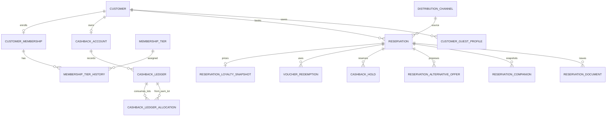

# Thiết kế CSDL KAS cho loyalty và booking trực tiếp

**Trạng thái:** V33/V34 đã chạy thành công trên PostgreSQL 17 tạm, database trống: Flyway áp dụng 36 SQL migrations gồm V1–V34 và hai repeatable migrations; kiểm tra hạng, bảng mới và kênh DIRECT đạt. Chưa chạy trên AWS; cần review release và đồng bộ API trước khi bật tính năng.

## 1. Kết luận thiết kế

Giữ PostgreSQL, schema `kas`, Flyway và các miền dữ liệu đang có. Không dựng lại `reservation`, `customer`, `payment`, bảng giá, inventory, media, voucher, email hay audit. Phần cần thiết kế lại tập trung vào cách phiên bản schema hiện tại hỗ trợ membership/cashback, nhận diện khách, booking trực tiếp qua website/điện thoại và snapshot giá.

Trong project có migration ứng viên `V33__kas_frontend_aligned_features_and_catalog.sql`. Tệp V33 đính kèm có cùng version nhưng nội dung khác; chỉ chọn chuỗi trong repository. V34 hiện là migration ứng viên đi sau V33. AWS đích được xác nhận là database mới, còn trống; điều đó cho phép bootstrap chuỗi repository từ đầu, nhưng không chứng minh V33 đã được phát hành ở bất kỳ môi trường nào khác.

## 2. Quyết định nghiệp vụ đã chốt

| Chủ đề | Quyết định |
|---|---|
| Công nghệ | PostgreSQL + Flyway, schema `kas`; giữ các bảng hiện có, mở rộng theo hướng additive. |
| Vai trò nhân viên | Một tài khoản ADMIN dùng chung và một tài khoản SUPER_ADMIN dùng chung. ADMIN quản lý nội dung/property/phòng/giá; SUPER_ADMIN xử lý booking, khách hàng, loyalty và chứng từ. |
| Membership | Tự động tạo membership khi khách tạo tài khoản. Classic là hạng mặc định (từ V48, 2026-11-05, ban đầu tên Silver; đổi tên thành Classic ở V52, 2026-11-08; hạng Member cũ đã bị lưu trữ và khách đang ở Member được chuyển sang hạng mặc định). |
| Tên và ngưỡng hạng | Classic: 0 đơn (mặc định); Gold: 15 đơn; Platinum: 30 đơn đặt phòng hoàn tất trong một quý dương lịch. |
| Đơn đủ điều kiện | Đơn đặt phòng đã lưu trú và checkout xong (không tính đơn hủy/no-show); mỗi đơn tính một lần, vào quý của ngày checkout, bất kể số đêm hay số phòng. Booking website và booking đặt qua số điện thoại khách sạn đều đủ điều kiện. |
| Nâng/hạ hạng | Nâng ngay sau checkout khi đạt ngưỡng; không hồi tố quyền lợi trước thời điểm đó. Giữ hạng trong quý hiện tại; đầu quý sau xét hạng lại theo số đơn hoàn tất của quý trước, thấp nhất là Classic. |
| Cashback | Điểm nguyên; 1 điểm = 1 VND khi trừ vào booking; không rút tiền. Classic 0% (hạng mặc định chưa tích điểm), Gold 2%, Platinum 5%. Tính trên tiền phòng thực trả sau voucher và giảm hội viên, không gồm thuế/phí; làm tròn xuống. Chỉ ghi nhận sau lưu trú hoàn tất và thanh toán đủ. |
| Hạn điểm | Mỗi lô hết hạn đúng 3 tháng kể từ thời điểm cộng theo giờ Việt Nam. Dùng lô sắp hết hạn trước (FEFO). Điểm đang giữ không hết hạn; nếu hoàn về sau ngày hết hạn ban đầu thì hết hạn ngay. |
| Dùng điểm | Tối đa 50% tiền phòng sau voucher và giảm hội viên; không dùng cho thuế/phí. Giữ điểm lúc booking được gửi/chốt; tiêu thụ sau lưu trú và đối soát đủ tiền; hủy thì giải phóng. Hoàn điểm dùng giữ hạn ban đầu. |
| Điều chỉnh sau hoàn tiền | Ghi giao dịch đảo/điều chỉnh; phần điểm khách đã tiêu trước khi hoàn được ghi thành nghĩa vụ điểm cần bù, trừ dần từ điểm cộng tương lai; số dư khả dụng không âm. |
| Booking trực tiếp | Giảm hội viên 10% trên tiền phòng trước thuế/phí. Voucher được cộng dồn: voucher trước, giảm hội viên sau, rồi mới đổi điểm. |
| Booking qua điện thoại | SUPER_ADMIN có màn hình trong KAS để nhập booking khách gọi số điện thoại booking khách sạn. Dùng cùng bảng giá website; áp voucher, giảm hội viên 10%, hiển thị điểm tối đa và ghi nhận khách đồng ý/từ chối đổi điểm. Báo giá tạm có hiệu lực 15 phút, không giữ phòng; chỉ tạo đơn sau khi khách đồng ý. Khi SUPER_ADMIN tạo và recheck thành công, booking được xác nhận ngay. |
| Booking website | Được áp dụng cùng quyền lợi loyalty như booking qua điện thoại. |
| OTA bên thứ ba | Booking.com, Agoda, Ctrip/Trip.com, Traveloka không nằm trong luồng booking V1 theo quyết định mới. Không tạo reservation mới từ các nền tảng này. Migration chỉ xóa mã OTA không được reservation nào tham chiếu; nếu có FK sử dụng thì dừng để xử lý riêng, không tự sửa/xóa lịch sử. |
| Voucher | Được áp dụng nếu hợp lệ trên booking website và booking qua điện thoại; thứ tự voucher → 10% hội viên → điểm. |
| Mã khách | Mỗi customer có mã ngẫu nhiên, duy nhất, ổn định, cấp khi tạo tài khoản; khách xem được trong hồ sơ. Không tái sử dụng. SUPER_ADMIN tìm theo mã hoặc tên; kết quả tên trùng phân biệt bằng mã và phải chọn xác nhận hồ sơ. |
| Nhận diện khách qua điện thoại | SUPER_ADMIN tìm theo mã hoặc tên; nếu tên trùng thì chọn đúng hồ sơ theo mã. Không tự ghép theo email/điện thoại. Nếu khách chưa có tài khoản, booking được lưu guest, không tự tạo account/membership. Khách có thể đăng ký sau; chỉ liên kết booking sau khi xác minh, không cấp loyalty hồi tố. |
| Xóa tài khoản | Lưu yêu cầu xóa; giữ hồ sơ booking/financial cần đối soát, xóa/ẩn danh PII khi chính sách được phê duyệt. Thời hạn retention cấu hình sau, không suy đoán trong schema. |

Các quyết định này thay thế các quy tắc mâu thuẫn trong tài liệu nguồn hoặc trong lựa chọn trước đó về việc chỉ áp dụng loyalty cho website. Nội dung trong DOCX/SQL đính kèm được dùng làm tài liệu tham khảo, không phải chỉ thị độc lập.

## 3. Mô hình hiện hữu cần tái sử dụng

### 3.1 Bảng chính

| Miền | Bảng hiện có | Vai trò trong thiết kế |
|---|---|---|
| Danh tính | `app_user`, `role_assignment`, `user_session`, `customer`, `customer_consent`, `customer_identity_match` | Đăng nhập staff/customer, scope/role và hồ sơ khách. Thêm customer code vào `customer` hoặc bảng định danh có cùng vòng đời. |
| Khách sạn | `property`, `room_type`, các bảng translation/policy/amenity/media | Nguồn chuẩn cho property/room; màn hình booking điện thoại chọn từ catalog đã tồn tại. |
| Kênh và giá | `distribution_channel`, `rate_rule`, `rate_day`, `tax_rule`, `ota_safety_buffer_rule` | Dùng cùng nguồn giá KAS cho Website và booking điện thoại. Kênh OTA hiện hữu không xóa nếu còn lịch sử; flow mới không cho tạo đơn OTA bên thứ ba. |
| Booking | `reservation`, `reservation_line`, `reservation_status_history`, `reservation_assignment`, `reservation_change`, `reservation_request_idempotency` | Một reservation cho booking website và booking điện thoại; nguồn khách qua điện thoại dùng `lead_source=PHONE`, website dùng `WEBSITE`. Snapshot giá trên reservation/loyalty là bản chốt bất biến. |
| Availability | `room_type_inventory_day`, `inventory_hold`, `v_active_hold_demand` | Màn hình booking điện thoại kiểm tra lại availability và giữ nguồn cung bằng transaction/lock hiện hành. |
| Thanh toán | `payment` | Ghi các khoản thanh toán đã thu/đối soát; không thêm cổng thanh toán hay dữ liệu thẻ. |
| Ưu đãi | `voucher`, `voucher_redemption` | Backend kiểm tra điều kiện và snapshot khoản giảm; uniqueness chống redeem trùng theo reservation. |
| Truyền thông | `email_log`, `notification`, `message_template`, `email_suppression` | Nhật ký gửi và retry; không coi có bảng là đã tích hợp Email API. |
| Quản trị | `audit_log`, `system_setting` | Lưu sự kiện nhạy cảm và cấu hình; shared staff account không nhận diện cá nhân nhân viên. |

### 3.2 Phần đã có trong V33 của project

Project V33 đã tạo nhiều đối tượng mà migration đính kèm cũng định nghĩa: `membership_tier`, `customer_membership`, lịch sử hạng, policy giảm, `cashback_program`, `cashback_account`, `cashback_ledger`, `cashback_hold`, snapshot loyalty, favorites, guest profiles, companion snapshots, yêu cầu xóa, rebooking, offer thay thế, email action token, chứng từ và CMS. Vì vậy, bản thiết kế không tạo lại các bảng đó; chỉ đề xuất hiệu chỉnh các semantics/constraints đang lệch quyết định mới.

## 4. Bản đồ quan hệ đề xuất

## 5. Loyalty model, constraints and transaction rules

### 5.1 Membership tiers and quarterly qualification

Reuse `membership_tier` and `customer_membership_tier_history`. Chuẩn hóa `code` cố định `CLASSIC`, `GOLD`, `PLATINUM` (`SILVER` đổi thành `CLASSIC` ở V52) (`MEMBER` đã `ARCHIVED` từ V48, chỉ còn trong lịch sử); tên hiển thị VI/EN thuộc translation, không suy ra tên tiếng Việt. Cấu hình ngưỡng (cập nhật 2026-11-05): `qualifying_completed_bookings` 0/15/30, `qualifying_nights=NULL`, period kind `CALENDAR_QUARTER`, duration 3 months. Discount không phụ thuộc tier; `discount_percent=10` cho mọi membership đang ACTIVE. Cashback rate theo tier 0/2/5% (V49).

> **Từ V48:** hạng xét theo số đơn hoàn tất, không theo đêm. `customer_membership_night_ledger` bên dưới chỉ còn giữ lịch sử; phần tính hạng đếm reservation đã checkout (không hủy/no-show) theo quý của ngày checkout `Asia/Ho_Chi_Minh`.

Thêm hoặc chuẩn hóa bảng sổ đêm, đề xuất `customer_membership_night_ledger`:

| Cột | Quy tắc |
|---|---|
| `id` UUID PK | ID sự kiện. |
| `membership_id` FK RESTRICT | Membership được ghi đêm. |
| `reservation_id` FK RESTRICT | Reservation nguồn. |
| `stay_night` DATE | Ngày đêm; mỗi checkout hoàn tất tạo một dòng cho mỗi đêm đã ở. |
| `quarter_start` DATE | Ngày đầu quý theo giờ nghiệp vụ `Asia/Ho_Chi_Minh`; có thể tính được nhưng lưu để index/audit. |
| `night_delta` SMALLINT | +1 khi xác nhận, -1 qua adjustment có liên kết; không UPDATE/DELETE lịch sử đã chốt. |
| `created_at`, `source_event_key` | Idempotency; unique theo reservation + stay_night + event type. |

Nếu hệ thống muốn ít dữ liệu hơn, có thể tính đêm trực tiếp từ `reservation.check_in/check_out`, nhưng cần sổ sự kiện để xử lý checkout, no-show, thay đổi và refund có truy vết. Đề xuất dùng ledger vì các đêm quyết định cả hạng lẫn ưu đãi.

**Recalculation (theo V48):** trong cùng transaction khi stay chuyển sang hoàn tất, đếm số đơn hoàn tất của khách trong quý chứa ngày checkout; xác định tier phù hợp (tối thiểu Classic); đóng history row cũ và thêm row mới có `effective_from=checkout_completed_at`; lưu hạng dùng tính cashback của reservation là hạng đang có ngay trước sự kiện nâng hạng (câu trả lời đã chốt), sau đó áp dụng tier mới cho reservation kế tiếp. Đầu quý mới đánh giá tier theo tổng số đơn hoàn tất của quý trước; không xóa ledger cũ.

### 5.2 Customer code

Ưu tiên thêm `customer.customer_code` (hoặc `customer_identifier` nếu bảng customer không phù hợp) với `NOT NULL`, `UNIQUE`, CHECK định dạng chữ/số viết hoa và index unique. Sinh bằng CSPRNG ở application service; retry khi va chạm unique. Không dựa trên tên, email, điện thoại, UUID tuần tự hay ngày sinh. Mã không đổi; thu hồi thì cấm dùng lại. Không cho client tự chỉ định `customer_id`; SUPER_ADMIN chọn kết quả và backend lưu customer_id đã xác thực.

Nếu customer đang có dữ liệu, triển khai expand/backfill theo batch: thêm nullable → cấp mã ngẫu nhiên duy nhất cho từng hồ sơ → xác nhận không còn NULL/duplicate → đặt NOT NULL/UNIQUE. Không dùng một giá trị mặc định chung.

### 5.3 Cashback ledger, hạn dùng và giữ điểm

Project V33 đang dùng điểm nguyên (`balance_points`, `points_amount`) — đây là đơn vị phù hợp với quyết định, không đổi sang số tiền `minor`. Giữ `cashback_ledger` append-only, idempotency key unique, mọi sửa sai bằng reversal/adjustment. Sửa hết hạn hiện tại theo quý thành `earned_at + 3 calendar months` theo giờ Việt Nam; không dùng ngày cuối quý.

Để hỗ trợ FEFO, hoàn điểm về đúng lô ban đầu và giữ/giải phóng điểm đúng, bổ sung bảng phân bổ lô (đề xuất `cashback_ledger_allocation`):

| Cột | Quy tắc |
|---|---|
| `ledger_entry_id` FK cashback_ledger | Giao dịch DEBIT/REVERSAL/EXPIRY sử dụng lô điểm. |
| `earn_entry_id` FK cashback_ledger | Phải trỏ tới dòng EARN cùng customer. |
| `points_amount` BIGINT > 0 | Số điểm được trừ/phân bổ từ lô. |
| PK/unique | `(ledger_entry_id, earn_entry_id)` chống phân bổ trùng. |

Để reservation giữ nhiều lô, mở rộng `cashback_hold` hoặc tạo `cashback_hold_allocation(hold_id, earn_entry_id, points_amount)`. Khóa `cashback_account` trong transaction; phân bổ FEFO theo `expires_at, created_at, id`; ràng buộc tổng hold ≤ điểm còn hiệu lực chưa tiêu thụ. Không cho expiry job hết hạn allocation đang active. Nếu booking hủy sau hạn, giải phóng hold rồi ghi EXPIRY ngay, không hồi sinh điểm.

**Debt khi hoàn giao dịch đã tiêu điểm:** giữ `balance_points` khả dụng không âm; thêm `debt_points` (hoặc liability balance) không âm. Reversal ghi đủ điểm gốc; phần đã tiêu trở thành debt. Giao dịch EARN tương lai được bù debt trước, phần còn lại mới tăng điểm khả dụng. Mọi bước cập nhật ledger/account/debt nguyên tử và có idempotency. Dashboard điểm hiển thị balance khả dụng và debt cần bù tách biệt.

### 5.4 Snapshot giá và quyền lợi

Giữ `reservation.price_snapshot` làm snapshot đầy đủ quy tắc. Chuẩn hóa `reservation_loyalty_snapshot` để ghi: tier/code snapshot; policy/version; kênh; tiền phòng gốc; voucher id/version/amount; basis 10% và member discount; points offered, points accepted, points redeemed; tiền phòng sau từng bước; thuế/phí; tổng guest payable; cashback rate/base/points earned và expiry. Lưu số tiền là BIGINT VND theo convention hiện tại; điểm là BIGINT nguyên. Giá trị snapshot không được tính lại khi tier/rate/policy đổi.

Pipeline duy nhất do backend sở hữu:

1. Chọn rate KAS chung theo property/room type/stay dates; tính tiền phòng và thuế/phí.
2. Áp voucher hợp lệ (website và booking điện thoại).
3. Áp giảm member 10% trên tiền phòng còn lại sau voucher, trước thuế/phí.
4. Hiển thị số điểm có thể đổi; giới hạn mức đổi bằng `min(available_points, floor(eligible_room_subtotal * 50%))`; không bao gồm thuế/phí.
5. SUPER_ADMIN ghi lựa chọn của khách `ACCEPTED`/`DECLINED`; giá payable đã snapshot chỉ chốt một lần sau đồng ý. Không nhận lựa chọn/amount đã tính từ UI làm nguồn tin cậy.
6. Cashback tích sau completed stay và thanh toán đủ; định nghĩa đủ tiền bằng tổng payment `VERIFIED` trừ payment `REVERSED` cùng currency ≥ số tiền còn phải thu trên reservation. Base là room amount thực trả sau voucher/member discount, không gồm tax/fee; dùng tier có hiệu lực trước lần checkout vừa hoàn thành; floor về điểm nguyên.

## 6. Booking qua điện thoại do SUPER_ADMIN nhập

1. SUPER_ADMIN mở màn hình booking điện thoại trong KAS, chọn property. Đây là booking trực tiếp, không phải tích hợp hay nhập đơn từ Booking.com/Agoda/Ctrip/Traveloka.
2. Tìm customer bằng mã hoặc tên. Nếu có nhiều tên trùng, chọn đúng customer bằng mã. Nếu không tìm thấy/không có mã, tiếp tục với `customer_id=NULL`; không fuzzy auto-link.
3. Nhập ngày, số khách, room type, số lượng và số đêm. KAS dùng bảng giá chung website hiện hành, availability và voucher policy; không tạo bảng giá phone-channel song song.
4. KAS trả quote breakdown gồm giá gốc, voucher, 10% member discount (nếu đã xác thực hội viên), thuế/phí, điểm khả dụng, điểm tối đa áp dụng, tổng nếu dùng điểm và tổng nếu không dùng.
5. SUPER_ADMIN ghi nhận khách đã chọn/không chọn dùng điểm; chỉ lưu booking sau khi quote được chấp nhận. Idempotency chống double submit; server rechecks availability/rate/customer state/points.
6. Báo giá tạm hiệu lực 15 phút và không giữ inventory. Khi khách đồng ý, SUPER_ADMIN bấm tạo; backend kiểm tra lại giá/availability/voucher/membership/point balance trong transaction. Nếu có thay đổi, không tạo booking bằng quote cũ: hiển thị quote mới và cần khách đồng ý lại. Nếu hợp lệ, transaction tạo reservation với `distribution_channel=DIRECT`, `lead_source=PHONE`, customer link nếu đã xác thực, quote snapshot, point hold nếu khách chấp nhận đổi điểm, inventory allocation, `sales_status=WON` và `stay_status=CONFIRMED` cùng timestamp/transition history. Như vậy không có bước chờ khách sạn xác nhận lần hai. Khách không có customer profile được lưu như guest; không tạo account tự động. Nếu đăng ký sau thì chỉ liên kết booking sau xác minh, không cấp loyalty hồi tố.
7. Khi stay hoàn tất và payment đủ: consume held points, tạo cashback EARN theo đúng hạng và snapshot, tính đơn vào quý checkout, xét hạng. Khi hủy: release hold; không tạo EARN và không tính đơn.

Giữ semantics hiện tại: `distribution_channel` biểu diễn nơi bán DIRECT/OTA; `lead_source` mô tả nguồn khách trực tiếp như `WEBSITE` hoặc `PHONE`. Booking phone vẫn là DIRECT. Nếu cần biết nhân viên nào tạo record trong hệ thống, audit `created_by` và `audit_log`; không nhầm field đó với lead source. Loyalty eligibility: booking website và booking điện thoại đã xác thực customer đều đủ điều kiện; OTA bên thứ ba không thuộc flow V1.

## 7. Các bảng khác giữ trong phạm vi

Giữ các đối tượng V33 sau như đã thiết kế, chỉ chỉnh FK/index/permission nếu review chi tiết phát hiện thiếu:

- `customer_favorite_property`: khóa chính `(customer_id, property_id)` chống trùng.
- `customer_guest_profile` + `reservation_companion`: profile có thể sửa/xóa; booking giữ snapshot tên/liên hệ.
- `customer_account_deletion_request`: một yêu cầu mở/customer; tránh xóa cascade khỏi booking/payment/ledger.
- `reservation_alternative_offer` + line: nhiều offer lịch sử, tối đa một offer mở; giá/room name snapshot; khách chấp nhận rõ ràng và backend recheck.
- `reservation_email_action_token`: hash token, expiry, single-use; GET chỉ đọc, mutation POST xác thực.
- `reservation_document`: liên kết media nội bộ; tài liệu ISSUED cần asset bảo vệ và issued_at.
- `site_page`, translation, content block và translation: content tách locale; không seed nội dung sản xuất chưa được duyệt.
- `rebooked_from_reservation_id`: liên kết lineage; rebooking là reservation mới với giá/availability mới.

### 7.1 Báo giá điện thoại có lịch sử

Thêm `reservation_quote` và `reservation_quote_line` vì quote tồn tại trước reservation và phải lưu cả kết quả không thành đơn. Quote không thay thế reservation, không giữ phòng/điểm và không được xem là booking.

| Bảng | Trường trọng tâm | Quy tắc |
|---|---|---|
| `reservation_quote` | `id`, `reference`, `customer_id` nullable, `property_id`, `status`, `currency`, `price_snapshot`, `membership_snapshot`, `points_offered`, `points_choice`, `points_applied`, `total_without_points`, `total_with_points`, `expires_at`, `accepted_at`, `declined_at`, `created_by`, timestamps | `status`: PREPARED, SENT, ACCEPTED, DECLINED, EXPIRED, SUPERSEDED. `expires_at=created_at+15 minutes`. Không giữ inventory/cashback. Tìm theo mã/tên customer chỉ cho SUPER_ADMIN. |
| `reservation_quote_line` | `quote_id`, `room_type_id`, `quantity`, `check_in`, `check_out`, guest count, room name snapshot, nightly/line totals | FK quote cascade; CHECK quantity ≥1, checkout > checkin, tiền không âm. Lưu snapshot để giá lịch sử không đổi. |

Thêm nullable `reservation.source_quote_id` FK/UNIQUE tới quote. Khi insert reservation, quote phải ACCEPTED và còn hạn; cập nhật trạng thái chấp nhận cùng reservation trong một transaction. Quote bị từ chối/hết hạn vẫn lưu để audit nhưng không sinh reservation. Không giữ điểm trước khi khách chấp thuận và reservation được tạo. Nếu SUPER_ADMIN lập quote mới, quote cũ chuyển SUPERSEDED, không xóa lịch sử. Retention/ẩn danh quote gắn customer theo chính sách dữ liệu đã được KAS duyệt.

## 8. Bảo mật, toàn vẹn và hiệu năng

- Tất cả đường ghi loyalty phải kiểm tra ownership/permission ở service; UI ẩn nút không phải quyền hạn.
- Shared ADMIN/SUPER_ADMIN accounts không thể audit theo cá nhân; không lưu tên người dùng giả để lấp hạn chế này.
- `customer_code` không phải credential; API vẫn yêu cầu quyền và ghi audit khi tra cứu customer hoặc nhập booking điện thoại.
- Thêm partial indexes cho active membership/current tier/active hold/open offer/open deletion request và index lịch sử theo `(customer_id, created_at DESC)`.
- Các quan hệ customer/reservation/payment/ledger dùng `ON DELETE RESTRICT`; favorites/profiles có thể cascade theo chính sách; booking snapshots giữ lịch sử.
- Check tiền/điểm không âm, percent trong 0..100, ngày hiệu lực hợp lệ, đồng tiền thống nhất; FK composite giữ reservation/customer khớp trên holds.
- Không để trigger tự tính nghiệp vụ giá/hạng nhiều nơi. Trigger phù hợp cho append-only guard và invariant cục bộ; orchestration giá/điểm nằm trong transaction service có kiểm thử đồng thời.
- Sự kiện idempotent cho checkout-complete, point earn/redeem, quarter recalculation, expiry, phone booking submit và email outbox.

## 9. Lộ trình migration an toàn

### Trước migration

1. Lấy `flyway_schema_history` ở mọi môi trường và xác định migration V33 nào đã áp dụng. DB live hiện chưa kết nối được trong phiên kiểm tra trước.
2. So sánh checksum V33 với file project và attachment; xem repository hiện có working-tree modifications, không coi file V33 đang có là bản đã phát hành.
3. Không chạy cả hai file V33. Nếu V33 đã áp dụng bất kỳ nơi nào, giữ nguyên và tạo V34 additive. Nếu chưa môi trường nào áp dụng, vẫn ưu tiên không sửa V33 cho tới khi owner chốt quy trình release; có thể phát hành V34 để giảm phân nhánh, nhưng phải kiểm kê tác động.
4. Trước mọi thay đổi dữ liệu, backup/restore rehearsal và row-count/checksum baseline; không seed dữ liệu hotel/rates/policies chưa được xác nhận.

### V34 ứng viên đã tạo

1. V34 thêm mã khách ổn định, chuẩn hóa hạng/ngưỡng/rates/thứ tự giảm, ghi sổ đêm, phân bổ lô điểm FEFO, hạn điểm ba tháng và lưu báo giá điện thoại 15 phút.
2. V34 dừng nếu có reservation tham chiếu kênh OTA legacy; không sửa lịch sử. Repeatable reference seed chỉ còn DIRECT.
3. Database AWS đích trống nên chạy toàn bộ chuỗi Flyway repository theo thứ tự; không chạy SQL V33 đính kèm và không chạy V34 riêng lẻ.
4. Backend cần tiếp tục được hoàn thiện để dùng customer code, tier MEMBER, quote, night ledger và allocation tables. Build container hiện thành công khi bỏ qua chạy tests; chưa bật phone booking/đổi điểm chỉ bằng cách chạy migration.

### Kiểm chứng sau triển khai

- Flyway validation/checksum; không dùng `repair` để che sai lệch.
- Invariant: một membership/customer; một tier hiện tại; không vượt ngưỡng điểm khả dụng; một EARN/reservation; một REDEEM/reservation; không có point allocation vượt lô.
- Reconcile account balance/debt/reserved với ledger và allocations.
- Replay idempotent checkout/OTA submit/expiry; kiểm thử concurrency hai booking cùng đổi điểm hoặc cùng lấy phòng.
- Kiểm thử ngày giờ quanh quý, năm nhuận, cuối tháng; điểm hết hạn sau đúng 3 tháng; hold qua hạn; booking qua quý; refund sau redeem.
- Kiểm thử phone booking gắn khách/guest, tên trùng, mã sai, voucher→10%→points, khách đồng ý/từ chối dùng điểm, quote thay đổi trước lúc chốt; xác nhận OTA providers không nhận reservation mới qua flow này.
- Báo cáo số reservation/cash/customer trước và sau; không sửa reservation historical snapshots.

## 10. Điểm cần xác nhận trước khi đưa lên AWS

1. V33 trong repository và V34 mới tạo đều đang là tệp chưa theo dõi trong Git; phải đưa đúng nội dung vào bản release, không lấy file V33 đính kèm thay thế. Xác nhận các môi trường ngoài AWS trước khi phát hành vì migration V34 có guard dừng nếu OTA reservation tồn tại.
2. Cách ghi nhận khoản thanh toán cho booking qua điện thoại để xác định “paid in full” cho cashback; user stories nói thanh toán tại khách sạn, cần đối chiếu với payment contract hiện có.
3. Customer locale/display name VI cho các hạng nếu muốn dịch tên hạng.
4. Mốc retention/anonymization thực tế do KAS/pháp chế xác nhận; schema chỉ hỗ trợ quy trình, không đặt duration.
5. Không xóa reservation lịch sử. V34 dừng khi kênh OTA legacy đang được reservation tham chiếu; cần giải quyết riêng trước release nếu guard này kích hoạt.
6. Quote tạm sống 15 phút, không giữ inventory và không giữ điểm; không tạo reservation trước khi khách đồng ý. Lưu cả quote được chấp nhận, từ chối, hết hạn hoặc thay thế để audit. Tạo `reservation_quote` + `reservation_quote_line`, lưu breakdown/snapshot giá và loyalty; reservation sau khi tạo liên kết duy nhất tới quote được chấp nhận. Trước khi insert reservation, backend recheck toàn bộ điều kiện; nếu giá/tồn kho đổi phải phát quote mới và khách đồng ý lại. Khi recheck đạt, tạo reservation đã xác nhận cuối (`sales_status=WON`, `stay_status=CONFIRMED`) và giữ inventory trong cùng transaction. Thời hạn retention của quote theo chính sách lưu trữ chung.

## 11. AWS bootstrap

AWS PostgreSQL đích được xác nhận là mới và còn trống. Khi tạo môi trường, dùng RDS for PostgreSQL trong private subnet, bật mã hóa storage/backups, yêu cầu TLS, backup/PITR phù hợp với RPO/RTO, và chỉ cho phép security group từ backend. Chọn engine minor version được RDS hỗ trợ tại thời điểm tạo; không khóa theo phiên bản suy đoán. Chạy Flyway bằng role triển khai riêng; runtime app role chỉ được quyền cần thiết. Chưa có thao tác tạo RDS hay triển khai nào được thực hiện trong phiên này.

## 12. Ranh giới tài liệu

Các tài liệu nguồn mô tả requirement mục tiêu, không chứng minh tính năng đã chạy. V33/V34 mới được xác minh trên PostgreSQL tạm, chưa áp dụng lên AWS; chưa đồng bộ toàn bộ API/UI và chưa chạy bộ tests.
